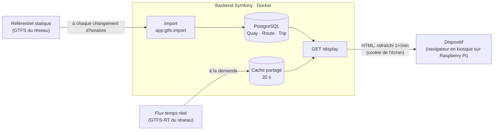

# Stopcast

Réplique en temps réel l'affichage du panneau d'un abri de bus sur un petit écran connecté (Raspberry Pi), pour l'arrêt de bus de votre choix : savoir d'un coup d'œil, depuis chez soi, quand partir attraper son bus.

<p align="center">
  
  
</p>

<p align="center"><sub>À gauche, le rendu du client d'affichage. À droite, l'afficheur en situation.</sub></p>

## En bref

Stopcast croise les deux flux de données ouvertes publiés par la plupart des réseaux de transport :

- le **GTFS statique** (lignes, arrêts, quais, destinations des trajets), importé en base ;
- le **GTFS-RT** (horaires en temps réel), interrogé et mis en cache à la volée.

Ce dépôt contient l'**application Symfony** qui reconstitue, pour un quai donné, ce qu'affiche le vrai panneau, et le sert sous forme de page d'affichage au navigateur en kiosque d'un Raspberry Pi, appairé par un code.

L'essentiel du travail porte sur la modélisation GTFS : un arrêt se compose de plusieurs quais (un par sens), une ligne peut avoir plusieurs terminus, et les identifiants des flux statique et temps réel doivent concorder. Détails dans [docs/architecture.md](docs/architecture.md).

## Fonctionnement



## Stack

PHP 8.5 · Symfony 8.1 · Doctrine ORM · Twig · Tailwind CSS · PostgreSQL 16 · FrankenPHP · Docker  
Qualité : PHPUnit, PHPStan niveau 10, PHP CS Fixer, Rector, CI GitHub Actions.

## Démarrage rapide

```bash
cp .env .env.local   # renseigner les URLs GTFS
make up && make migrate && make import
```

## Documentation

- [Architecture et modèle de données](docs/architecture.md)
- [Variables d'environnement](docs/configuration.md)
- [Développement : installation, outils, conventions](docs/developpement.md)
- [Exploitation : déploiement et secrets de production](docs/exploitation.md)
- [Accessibilité : revue WCAG 2.2 AA](docs/accessibilite.md)
- [Données personnelles : registre des traitements et sous-traitants](docs/rgpd.md)

## État du projet

Proof of concept fonctionnel : import GTFS, exploitation du flux temps réel, gestion multi-dispositifs, page d'affichage appairée par code. Comptes utilisateurs, connexion, gestion de ses dispositifs et de leurs configurations d'affichage (choix des quais, ordre de rotation) dans l'espace web en place ; emails et gestion des comptes par un administrateur sont en cours. Prochaine étape : script d'installation du Raspberry Pi en kiosque.

## Sources des données

Données : [TCAT – Troyes Champagne Métropole](https://transport.data.gouv.fr/datasets/donnees-tcat-troyes-champagne-metropole-1), [licence ODbL](https://opendatacommons.org/licenses/odbl/1.0/), via transport.data.gouv.fr.

Stopcast importe le référentiel statique de ce jeu de données (lignes, arrêts, quais, trajets) et interroge son flux temps réel pour afficher les prochains passages. L'application publie la même attribution sur sa page `/sources`, liée depuis le pied de page.

## Licence

[MIT](LICENSE)

Ressources tierces : la police [Roboto Condensed](https://github.com/googlefonts/roboto-classic) de la page d'affichage (`assets/fonts/`, instance statique au poids 700), © The Roboto Project Authors, est distribuée sous [SIL Open Font License 1.1](assets/fonts/OFL.txt).

---

<sub>Projet personnel, développé pour mon propre usage : les contributions ne sont pas attendues. Faille de sécurité : voir [SECURITY.md](SECURITY.md).</sub>
