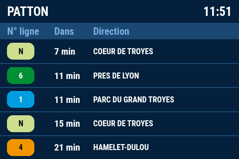
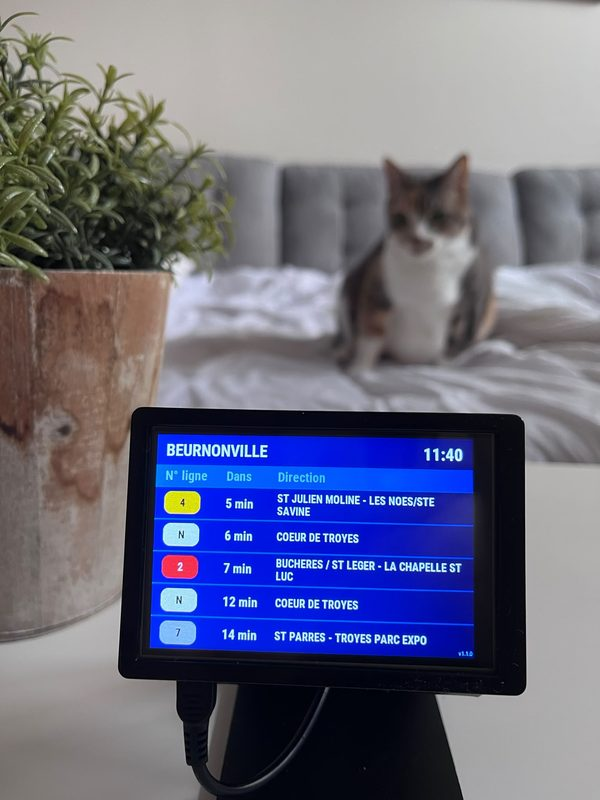

# Abribus

Réplique en temps réel l'affichage d'un panneau d'abribus sur un petit écran connecté (Raspberry Pi), pour l'arrêt de bus de votre choix : savoir d'un coup d'œil, depuis chez soi, quand partir attraper son bus.

<p align="center">
  
  
</p>

<p align="center"><sub>À gauche, le rendu du client d'affichage. À droite, l'afficheur en situation.</sub></p>

## En bref

Abribus croise les deux flux de données ouvertes publiés par la plupart des réseaux de transport :

- le **GTFS statique** (lignes, arrêts, quais, destinations des trajets), importé en base ;
- le **GTFS-RT** (horaires en temps réel), interrogé et mis en cache à la volée.

Ce dépôt contient l'**API Symfony** qui reconstitue, pour un quai donné, ce qu'affiche le vrai panneau, et la sert à un écran Raspberry Pi authentifié par token. Le client d'affichage (Python) vit dans un dépôt séparé : [AbribusDisplay](https://github.com/v-gael/AbribusDisplay).

L'essentiel du travail porte sur la modélisation GTFS : un arrêt se compose de plusieurs quais (un par sens), une ligne peut avoir plusieurs terminus, et les identifiants des flux statique et temps réel doivent concorder. Détails dans [docs/architecture.md](docs/architecture.md).

## Exemple de réponse

`GET /api/next-passages`, avec le token du dispositif dans le header `X-Device-Token` :

```json
{
    "@context": "/api/contexts/NextPassagesResponse",
    "@id": "/api/next-passages",
    "@type": "NextPassagesResponse",
    "generatedAt": "2026-09-14T11:51:37+00:00",
    "displays": [
        {
            "@type": "DisplayItem",
            "@id": "/api/.well-known/genid/c0a153f21e347dbd678f",
            "label": "Direction centre-ville",
            "quayName": "MAIRIE",
            "nextPassages": [
                {
                    "@type": "NextPassage",
                    "@id": "/api/.well-known/genid/fb7fefd37b17d28cc134",
                    "routeShortName": "4",
                    "routeColor": "F29400",
                    "routeTextColor": "000000",
                    "headsign": "CENTRE VILLE",
                    "expectedAt": "2026-09-14T12:05:15+00:00"
                },
                {
                    "@type": "NextPassage",
                    "@id": "/api/.well-known/genid/0bbe514449415a404eff",
                    "routeShortName": "4",
                    "routeColor": "F29400",
                    "routeTextColor": "000000",
                    "headsign": "HÔTEL DE VILLE",
                    "expectedAt": "2026-09-14T12:21:57+00:00"
                }
            ]
        }
    ]
}
```

## Stack

PHP 8.5 · Symfony 8.1 · API Platform 4 · Doctrine ORM · PostgreSQL 16 · FrankenPHP · Docker  
Qualité : PHPUnit, PHPStan niveau 10, PHP CS Fixer, Rector, CI GitHub Actions.

## Démarrage rapide

```bash
cp .env .env.local   # renseigner les URLs GTFS
make up && make migrate && make import
```

## Documentation

- [Architecture et modèle de données](docs/architecture.md)
- [API et variables d'environnement](docs/api.md)
- [Développement : installation, outils, conventions](docs/developpement.md)

## État du projet

Proof of concept fonctionnel : import GTFS, exploitation du flux temps réel, gestion multi-dispositifs, endpoint `/api/next-passages`. API d'administration protégée par clé. Prochaine étape : finalisation du client d'affichage.

## Licence

[MIT](LICENSE)
