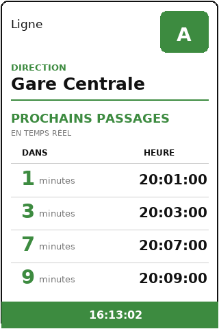

# Abribus

Réplique en temps réel l'affichage d'un panneau d'abribus sur un petit écran connecté (Raspberry Pi), pour l'arrêt de bus de votre choix : savoir d'un coup d'œil, depuis chez soi, quand partir attraper son bus.

<p align="center">
  
</p>

## En bref

Abribus croise les deux flux de données ouvertes publiés par la plupart des réseaux de transport :

- le **GTFS statique** (lignes, arrêts, quais), importé en base ;
- le **GTFS-RT** (horaires en temps réel), interrogé et mis en cache à la volée.

Ce dépôt contient l'**API Symfony** qui reconstitue, pour un quai donné, ce qu'affiche le vrai panneau, et la sert à un écran Raspberry Pi authentifié par token. Le client d'affichage (Python) vit dans un dépôt séparé.

L'essentiel du travail porte sur la modélisation GTFS : un arrêt se compose de plusieurs quais (un par sens), une ligne peut avoir plusieurs terminus, et les identifiants des flux statique et temps réel doivent concorder. Détails dans [docs/architecture.md](docs/architecture.md).

## Stack

PHP 8.4 · Symfony 8.1 · API Platform 4 · Doctrine ORM · PostgreSQL 16 · FrankenPHP · Docker  
Qualité : PHPUnit, PHPStan niveau 10, PHP CS Fixer, Rector, CI GitHub Actions.

## Démarrage rapide

```bash
cp .env .env.local   # renseigner les URLs GTFS
make up && make migrate && make import
```

## Documentation

- [Architecture et modèle de données](docs/architecture.md)
- [API et variables d'environnement](docs/api.md)
- [Développement : installation, outils, conventions](docs/developpement.md)

## État du projet

Proof of concept fonctionnel : import GTFS, exploitation du flux temps réel, gestion multi-dispositifs, endpoint `/api/next-passages`. Prochaines étapes : authentification des endpoints d'administration et finalisation du client d'affichage.

## Licence

[MIT](LICENSE)
